# DR Dubber Pro — Architecture

Last updated: 2026-11-17 (v1.17.1)

This document explains how the app works inside: its processes, the flow of every pipeline, and where state is stored. It is for people who change the code. To install and use the app, read [DOCUMENTATION.md](DOCUMENTATION.md).

File references name the function rather than a line number, because line numbers change with every edit. `studio-main.js` means `frontend/js/studio-main.js`, and `gemini.js` means `backend/routes/gemini.js`.

## Contents

1. [System overview](#1-system-overview)
2. [Startup and shutdown](#2-startup-and-shutdown)
3. [Security](#3-security)
4. [Code map](#4-code-map)
5. [State and storage](#5-state-and-storage)
6. [The tab model](#6-the-tab-model)
7. [Transcription](#7-transcription)
8. [Gemini key pool and rotation](#8-gemini-key-pool-and-rotation)
9. [Translation features](#9-translation-features)
10. [Gemini Web Router](#10-gemini-web-router)
11. [Voices](#11-voices)
12. [Fitting voices to the timeline](#12-fitting-voices-to-the-timeline)
13. [Isolate BGM](#13-isolate-bgm)
14. [Blur Subtitles and Match Subtitles to Video](#14-blur-subtitles-and-match-subtitles-to-video)
15. [Render](#15-render)
16. [Join episodes and split movie](#16-join-episodes-and-split-movie)
17. [Dub Whole Series](#17-dub-whole-series)
18. [Background jobs and batch transcription](#18-background-jobs-and-batch-transcription)
19. [Preview and waveforms](#19-preview-and-waveforms)
20. [HTTP API reference](#20-http-api-reference)
21. [IPC reference](#21-ipc-reference)
22. [Known issues and loose ends](#22-known-issues-and-loose-ends)

## 1. System overview

Everything runs on the user's computer except the AI services: Gemini (by API key, or through the Gemini Web Router's Gmail accounts), CodeCraft for text jobs, and Microsoft's Edge TTS. The Electron main process loads the Express backend in-process. The window talks to the backend over HTTP on 127.0.0.1:3001 and to `main.js` over IPC. FFmpeg and Python do the media work as child processes.

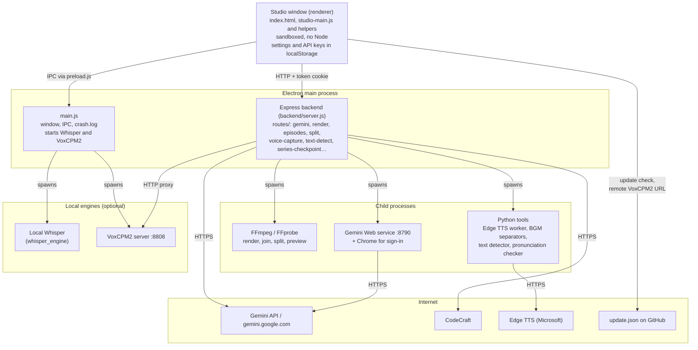

The window reads and writes local files only through the backend or IPC. It does make some internet requests of its own: it fetches `update.json` when you press **Check for Updates**, and it can call a remote VoxCPM2 server URL directly.

## 2. Startup and shutdown

### Startup

`npm start` builds the Tailwind CSS (`prestart`), then runs `electron .`.

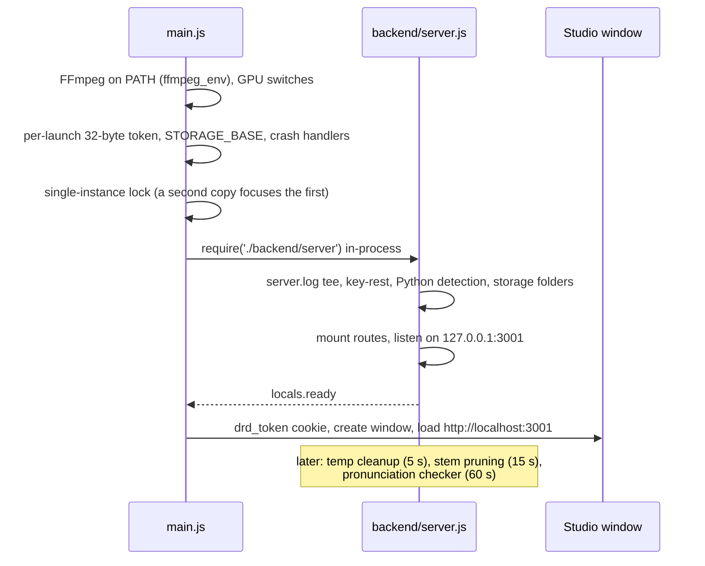

- `STORAGE_BASE` is `<userData>/storage` when the app is packaged, and `<repo>/storage` in development. `main.js` always sets `APP_STORAGE_DIR`, so a value set outside is ignored under Electron.
- If the backend can't start, the app shows an error box and quits. The error has its own message when port 3001 is already taken.
- An uncaught exception is written to `storage/logs/crash.log` and shown in a box. The app keeps running.
- Python detection runs probes of up to 2.5 s each at startup, which can make startup slower on some machines.
- Nothing heavy starts at boot:
  - The Edge TTS worker starts on the first voice.
  - Whisper runs per job.
  - VoxCPM2 starts when the user presses **Start Server**, or when a series run needs it.
  - The Gemini Web service starts when it is first needed.

### Shutdown

`before-quit`, `will-quit` and `window-all-closed` run `cleanupChildProcesses` in `main.js`, which kills Whisper jobs and the VoxCPM2 server. `lib/process-tracker.js` kills every other tracked child on exit: FFmpeg, Python, the TTS worker, separators, the Gemini Web service and its Chrome, the text detector and the pronunciation checker. The key-rest file and the `server.log` buffer are flushed on exit.

## 3. Security

| Layer | What it does | Where |
| --- | --- | --- |
| Loopback | The backend listens on 127.0.0.1 only | `server.js` |
| Host / Origin guard | Rejects a foreign `Host` (stops DNS rebinding) and a foreign `Origin`, and requires `Sec-Fetch-Site` to be same-origin or none | `lib/security.js` |
| Token | Every request needs the `drd_token` cookie (HttpOnly, SameSite=strict) or an `x-drd-token` header, compared in constant time. `npm run server` prints a `/?t=<token>` login URL instead | `lib/security.js` |
| CSP | Scripts from self plus hashes of the inline handlers in `index.html`, worked out at startup; frames limited to YouTube and Drive; nosniff, `X-Frame-Options: DENY`, no-referrer | `lib/security.js` |
| Renderer | `contextIsolation`, `sandbox`, no Node, no webviews; window.open denied; navigation away from the app's origin blocked; every IPC call checks that the sender's origin is the app's | `main.js` |
| Paths | Network paths (UNC, `file://host`) refused everywhere; only allowed file types are served; output names cleaned | `lib/security.js`, `lib/paths.js` |
| Local programs | Whisper and VoxCPM2 scripts need a one-time approval in a native dialog, remembered in `approved-programs.json` | `main.js` |
| Outgoing HTTPS | Electron `net.fetch` (OS certificate store, system proxy); `DR_DUBBER_ALLOW_INSECURE_TLS=1` turns off certificate checks | `lib/secure-fetch.js` |

`/storage` serves the whole storage folder to anyone who has the token, including `storage/gemini_web/cookies`.

## 4. Code map

### Backend

| Module | Role |
| --- | --- |
| `backend/server.js` | Express app (about 1,900 lines): middleware, `/api/audio`, extract audio, save SRT, batch results, Isolate BGM, Edge TTS, VoxCPM2 proxy, background jobs |
| `backend/routes/gemini.js` | Everything Gemini (about 3,700 lines): transcribe, translate, repair, review, rewrite, key rotation, model choice, Check limits |
| `backend/routes/gemini-web.js` | Gemini Web Router page API |
| `backend/routes/render.js` | Render jobs: at most 2 at once, held while a subtitle search runs |
| `backend/routes/episodes.js`, `split.js` | Join episodes, split a movie |
| `backend/routes/voice-capture.js` | Voice clips from the video, speakers, per-line reference cuts |
| `backend/routes/text-detect.js` | Burned-in subtitle detection jobs |
| `backend/routes/series-checkpoint.js` | Series checkpoints on disk |
| `backend/routes/pronunciation.js` | The Edge pronunciation checker |
| `backend/routes/system.js`, `preview.js`, `waveform.js` | Encoders, open folder, preview copies, waveform peaks |
| `backend/render_service.js` | FFmpeg render pipeline |
| `backend/episode_joiner.js`, `video_splitter.js` | Joining and splitting |
| `backend/text_detect_service.js` | Queue and cache for `text_detector.py` |
| `backend/media_preview.js` | Playable preview copies |
| `backend/audio_repair.js` | Fixes AAC audio whose sample rate changes part-way through |
| `backend/ffmpeg_env.js` | Finds the bundled or system FFmpeg |
| `backend/lib/khmer-prompts.js` | Khmer rules, prompts, syllable budget (4.5 per second), SRT parsing |
| `backend/lib/character-sheet.js` | Per-series names, genders and forms of address; speakers list; cast frames |
| `backend/lib/missing-lines.js`, `split-lines.js` | Voicing on-screen lines that have no subtitle; splitting a line across several on-screen subtitles |
| `backend/lib/text-rules.js` | Strips foreign script from Khmer; builds TTS arguments |
| `backend/lib/key-rest.js` | Remembers resting keys across restarts and across the installed and repo copies |
| `backend/lib/codecraft.js` | CodeCraft client for `cc_` keys (text only) |
| `backend/lib/gemini-web-router.js`, `gemini-web.js`, `gemini-web-timing.js` | Gemini Web Router (section 10) |
| `backend/lib/tts-worker.js` | Keeps one Edge TTS Python worker alive |
| `backend/lib/request-errors.js` | Logs why requests from the window to the backend failed (Chromium's `net::ERR_…`), one line per burst |
| `backend/lib/voxcpm-installer.js` | One-click VoxCPM2 install |
| `backend/lib/bgm-cache.js` | Separated-stem cache and BGM job bookkeeping |
| `backend/lib/pc-profile.js` | Settings → Performance: the PC's group (light / standard / strong) from its RAM and CPU threads, and the limits of each group (`GET/POST /api/performance`, saved in `storage/performance.json`) |
| `backend/lib/memory-guard.js` | Holds the next heavy job (export, Isolate BGM, Remove music, subtitle search, preview) while free RAM is short and another of ours runs |
| `backend/lib/limiter.js` | At most N tasks at once; caps Transcribe's FFmpeg runs across every tab |
| `frontend/js/pc-profile.js` | `pcLimit(name, fallback)` for the page, and the Performance section of Settings |
| `backend/lib/text-blur.js`, `video-color.js` | FFmpeg filters for text blur and colour |
| `backend/lib/batch-results.js` | Finished transcripts saved per video file |
| `backend/lib/pronunciation.js` | Pronunciation checker driver |
| `backend/lib/audio-peaks.js` | Waveform peaks |
| `backend/lib/security.js`, `paths.js`, `secure-fetch.js`, `proxy.js`, `server-log.js`, `process-tracker.js` | Plumbing |

### Python (`backend/python/`)

| Script | Role |
| --- | --- |
| `tts_generator.py` | Edge TTS: one line, or a worker serving many (`--serve`) |
| `vocal_separator.py`, `onnx_separator.py`, `music_remover.py` | Isolate BGM: MDX-Net, Demucs, Spleeter, plus an optional pass that removes the music too |
| `text_detector.py` | RapidOCR burned-in subtitle detection |
| `voxcpm2_server.py`, `voxcpm2_speakers.py`, `voxcpm2_fetch_model.py` | VoxCPM2 server (copied to `app.py`), speaker voice prints, model download |
| `pronunciation_checker.py` | Compares Edge's Khmer to Google's reading |
| `gemini_web_server.py`, `gemini_web_timing.py` | Gemini Web Router service; line timing from the audio |
| `transcriber.py` | Old SRT helper; nothing calls it |

### Frontend (`frontend/js/`)

| Module | Role |
| --- | --- |
| `studio-main.js` | The editor and almost all UI logic (about 29,000 lines): tabs, timeline, transcribe, voices, fitting, BGM, blur, render queue, series run |
| `dai-transcribe-studio.js` | DAI-Transcribe Studio: the batch queue, the translator, "Transcribe All Tabs" |
| `backend-jobs.js` | Long requests as background jobs (`postJob`), polling helper |
| `transcribe-stepper.js` | Extract → Translate → Polish progress |
| `text-ai.js` | Text provider settings (Gemini or CodeCraft) |
| `gemini-models.js` | Model list and retired-model mapping |
| `gemini-web-modal.js` | Gemini Web Router page |
| `name-consistency.js` | Planning name fixes (also used by the backend) |
| `khmer-speech.js` | Turns numbers, abbreviations and so on into spoken Khmer |
| `subtitle-layout.js` | Khmer subtitle line breaking, shared by the preview and the export |
| `screen-sync.js` | Match Subtitles to Video |
| `timeline-visuals.js` | Thumbnails and waveforms on the timeline |
| `vox-speakers.js`, `vox-groups.js`, `vox-gallery.js`, `vox-install.js`, `voice-capture.js` | VoxCPM2 speakers, voice sets, gallery, installer, manual capture |
| `layout-shell.js`, `i18n.js`, `i18n-km.js`, `electron-compat.js` | Layout, English/Khmer interface, Electron bridge |
| `frontend/pitch-shifter-processor.js` | Real-time pitch preview (AudioWorklet) |

## 5. State and storage

### On disk

| Where | What |
| --- | --- |
| `storage/` | `STORAGE_BASE`, see section 2 |
| `storage/uploads`, `audio_cache`, `separated`, `preview_cache`, `audio_repair`, `exports`, `outputs` | Working media; **Clear Cache** empties the caches |
| `storage/separated/bgm-cache/<key>/` | Cached BGM and vocal stems (section 13) |
| `storage/batch_results/` | Finished transcripts per video file |
| `storage/character_sheets/` | Per-series character sheets, speakers and cast frames |
| `storage/series_checkpoints/` | Series tab and export checkpoints (removed after 30 days) |
| `storage/text_detect/` | Cached subtitle detections |
| `storage/models/`, `storage/python/` | Downloaded models; Python scripts copied out of the app package |
| `storage/VoiceCaptures/` | Voice clips saved by hand |
| `storage/pronunciation/state.json` | Pronunciation fixes |
| `storage/gemini_web/` | Gemini Web Router accounts, settings, cookies |
| `storage/logs/` | `crash.log`, `server.log` (rotated at 5 MB, two old copies kept), `voxcpm_debug.log` |
| userData | `approved-programs.json`, `presets.json`, `device_id.txt`, `gemini_key_rest.json`, and Chromium's Local Storage |
| `~/DR Dubber VoxCPM2/` | VoxCPM2 install (venv, model, cache) |
| `~/DR Dubber Gemini Web/` | Gemini Web Router venv and Chrome profiles |
| `Desktop/transcribe output`, and `C:\Export\AIDubber\outputs` on Windows | Extra copies of auto-saved SRTs |

### localStorage (in the window)

API keys and settings live in the window's localStorage, not in a file. The main keys are:

| Keys | What |
| --- | --- |
| `aiDubberApiKeys` (legacy `aiDubberApiKey`) | Gemini keys; sent with each request |
| `aiDubberModel`, `aiDubberApiSaver`, `aiDubberReviewPass` | Gemini model and options |
| `aiDubberTextProvider`, `aiDubberCodecraftKeys`, `aiDubberCodecraftModel`, `aiDubberCodecraftBackup` | CodeCraft text provider |
| `aiDubberTranscriptionEngine`, `aiDubberWhisperFolder` | Transcription engine |
| `aiDubberVocalEngine`, `aiDubberUseGPU`, `aiDubberDemucsSegment`, `aiDubberRemoveMusic` | Isolate BGM |
| `aiDubberRenderEngine`, `aiDubberNormalizeLoudness`, `aiDubberDialogueMastering`, `drDubberDuckingEnabled`, `drDubberDuckingDepth`, `aiDubberBgmVolume` | Render and mix |
| `aiDubberConcurrentAudio`, `aiDubberExportPath`, `aiDubberTempPath` | Voices and output folders |
| `aiDubberAutoSaveSrt*` | Auto-save subtitles |
| `aiDubberGlossary`, `aiDubberDramaGlossary`, `dr_dubber_drama_genre`, `aiDubberPronunciations` | Translation and speech |
| `aiDubberSub*`, `drDubberSubPreset` | Subtitle style |
| `aiDubberSeriesRun`, `aiDubberSeriesPrefs`, `aiDubberSeriesParallel`, `aiDubberSeriesRetries` | Series run plan and window settings |
| `voxcmp2_settings`, `voxSpeakerPrints` | VoxCPM2 |
| `uiLanguage`, `aiDubberThemes`, `aiDubber_videoPresets`, `aiDubber_colorPresets`, `aiDubber_autoPreset`, `lastPath:*` | Interface |

Nothing else in the window is saved. Open tabs are lost when the app closes, except tabs in a series run, which are checkpointed (section 17).

## 6. The tab model

`studio-main.js` keeps all open videos in `projects[]`, up to `MAX_PROJECT_TABS` = 20. `createEmptyProjectState(file)` builds a tab:

| Part | Fields |
| --- | --- |
| Media | `file`, `videoFilePath`, `blobUrl`, `previewBlobUrl`, `duration`, `videoWidth/Height` |
| Lines | `subtitles[]`: each row has `text` (Khmer), `originalText`, `textStart/textEnd`, gender (a voice preset key), emotion, `audioStatus`, `file`/`audioUrl`, `audioStart/audioEnd`, `speed`, `baseAudioDuration`, and `screenMatched`/`screenParts` after matching |
| Audio | `detachedAudios[]`, `bgmTrack` (src, start, volume, fades, `levelDb`, `bgmMethod`), `isOriginalAudioMuted` |
| Picture | flip, pan/zoom/scale, `cropConfig`, `blurBoxes`, `videoColorAdj`, `videoVignette`, `freeTexts[]` |
| Subtitle style | colour, font, outline, shadow, `marginV` |
| Burned-in subtitles | `textBlur` = {videoPath, segments, lines, row, enabled} |
| Jobs | `isTranscribing`, `isGeneratingAudio`, `isIsolatingBgm`, `isRendering`, `isDetectingText`, and their AbortControllers |
| VoxCPM2 | `voxGroupId` (the voice set for this movie) |

Only one tab is shown. The editor's global variables hold the shown tab. `saveCurrentProjectState()` copies them back into `projects[i]`, and `restoreProjectState(i)` loads a tab. `switchProject` does both. `closeProjectTab` aborts the tab's jobs and frees its URLs. Other modules reach tabs through `window.dubberBridge`: `tabList`, `applyTranscriptToTab`, `isTabBusy`, `setTabWorking`.

## 7. Transcription

There are two engines. **Direct** (the default) has Gemini listen to the audio and write Khmer lines with times, speaker, gender and emotion in one step. **Whisper + Translate** has local Whisper write the original-language subtitles, which Gemini then translates.

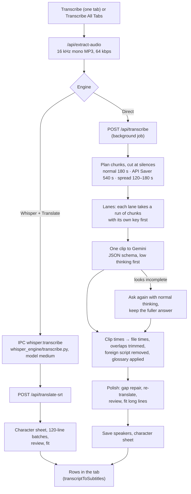

### Direct, step by step (`POST /api/transcribe`)

1. **Key pool.** API keys plus Gemini Web Router Gmails, in `orderPool` order (section 8). CodeCraft is never used for audio.
2. **Context.** The series character sheet and speakers list (section 9), the glossary and the drama genre's register go into the prompt.
3. **Chunk plan** (`planTranscribeChunks`). Cuts snap to the middle of the nearest silence (`silencedetect -35 dB, 0.3 s`).

   | Plan | Target chunk | One request up to |
   | --- | --- | --- |
   | Normal | 180 s | 240 s |
   | API Saver | 540 s | 600 s |
   | Spread (a series tab with borrowed keys) | total ÷ lanes, 120–180 s | target × 4/3 |

   API Saver and spread are turned off when Gmail lanes exist. Spread is also skipped for 10 minutes after the key pool has been paused (section 8).
4. **Piece memory.** Finished pieces are kept for 3 hours per file, model and settings, so a retried tab asks only for the pieces it is missing.
5. **Video or audio.** By default each clip is sent as small video (360p, 2 fps), so Gemini sees who speaks. If the clip would be 15 MB or more, it is sent as MP3. Pictures of up to 12 known speakers (2 frames each) go with the first clip.
6. **Lanes.** The lane count is the smallest of three numbers: the Gmail lanes (or, without Gmails, the number of keys), 24, and the chunk count (with spread) or half the chunk count rounded up (without). Lane *n* uses the key pool rotated by *n*, takes a contiguous run of chunks, and sends Gemini the lane's last 4 lines as context. The next clip is cut while the current one is with Gemini.
7. **One clip** (`transcribeClipWithGemini`). The response schema is an array of `{start, end, originalText, text, speaker, gender, emotion}`, with times relative to the clip. An answer counts as incomplete when it is cut off, or when a clip over 90 s has fewer than one line per minute; it is then asked again with normal thinking. Clip answers are cached for 3 hours.
8. **Times.** `normalizeClipCues` clamps the times to the clip and adds the chunk offset. `finalizeCues` sorts the lines and trims overlaps.
9. **Polish.**
   - `repairTranscript` re-listens to gaps of 20 s or more (skipped in API Saver unless a chunk was cut off).
   - Untranslated lines are always re-translated.
   - `reviewKhmerLines` corrects lines (100 per request), unless `review:false`.
   - `fitOverlongLines` shortens lines too long for their time, unless `fitToTime:false`; series runs send false.
10. **Save.** The speakers, cast frames and character sheet are updated in the background.
11. **Into the editor.** `transcriptToSubtitles` maps each line to a row, and `defaultVoiceFor(gender, speaker)` picks its voice.

### Whisper + Translate

- `whisper:transcribe` (IPC) runs the user's `whisper_engine` folder (`run.bat`/`run.sh`) with model `medium`, beam size 2. The raw SRT is shown and auto-saved.
- If the tab already has subtitles, Whisper is skipped and the existing lines are translated again.
- `POST /api/translate-srt` translates in batches of 120 lines over several lanes, with the character sheet and the 4 previous lines as context. Lines missing from an answer are asked once more. A `[Male]`/`[Female]` tag in the SRT overrides Gemini's guess. Then come review and fit, as in Direct.
- Whisper's times are kept. Lines get no speaker names in this mode.

### Timeouts

| What | Time |
| --- | --- |
| One audio attempt | clamp(60 s + 0.75 × clip length, 120 s, 240 s) |
| One text attempt | 120 s |
| A Gemini Web Router request | at least 10 min |
| Waiting out busy (503) answers, transcription | 30 min; text jobs 3 min |

## 8. Gemini key pool and rotation

Only the backend calls Gemini. The window sends every saved key with each request, and the backend picks which to use.

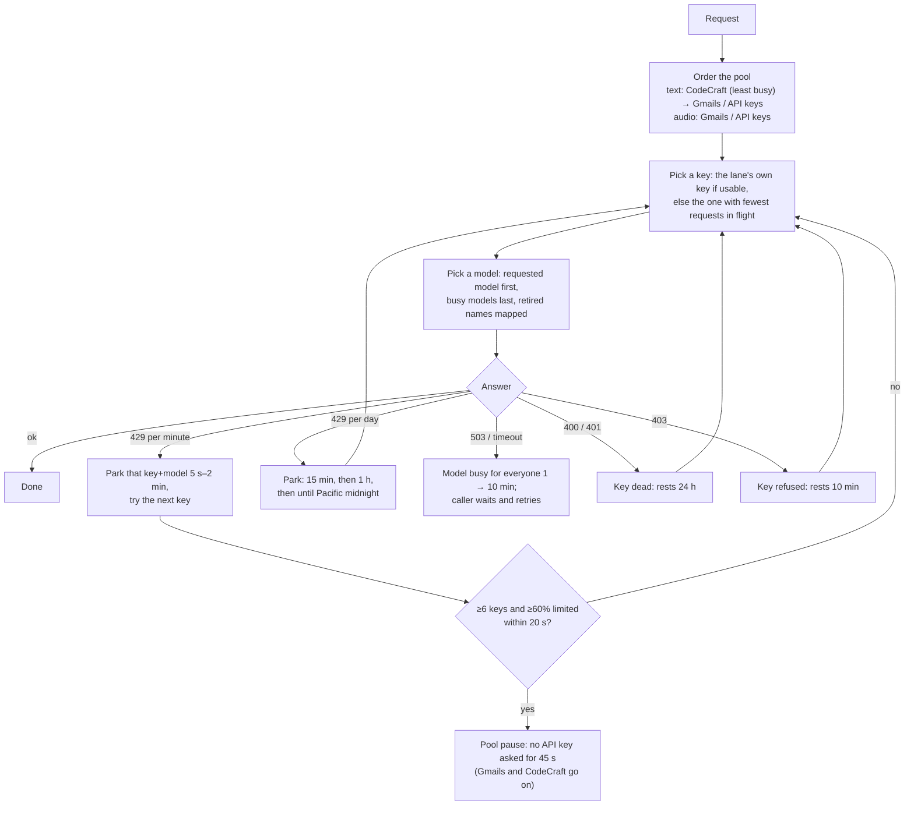

- **Order** (`orderPool`). With the Router off, Gmail keys are removed. With **Router first** on (the default), Gmails come first, then API keys. **Gmails only** uses Gmails alone while any is present.
- **Retries** (`geminiWithKeys`). Busy answers (503, `GWEB_BUSY`, `GWEB_SIGNED_OUT`) are retried until the busy budget runs out. Other failures get up to 2 retries by default: none after a daily quota, 1 after a network error. Waits are 5, 15, 30 then 60 s; a rate limit waits its retry time, from 2 to 90 s.
- **A 503 does not move to the next key**, because the other keys would ask the same busy model. The exception is when this key's other models are rate-limited.
- **Daily limits.** Google sometimes sends false "per day" limits, so a key is not trusted to be out for the day until its third strike. A wait of over 10 minutes given by Google is trusted.
- **Models.** `resolveGeminiModel` maps retired names: 3.7 Flash → 3.8 Flash, 3.5 Flash → 3.6 Flash, and older names to 3.8 or 3.6 Flash. `rankGeminiFallbacks` keeps up to 4 fallbacks plus the newest Pro: Flash before Pro, stable before preview, newer first. Flash Lite, `-transcribe` models, 2.x and older are never used. A model that answers 404 is skipped for 6 h. `stayOnModel` (series transcription) keeps to the chosen model, because other models split the dialogue differently.
- **Key rest** (`lib/key-rest.js`). Rest records are saved to `gemini_key_rest.json` in userData, with each key stored as a sha256 hash. Every 20 s the file is merged with the other app copy's records (installed and repo). Only daily and dead-key rests survive a restart.
- **Check limits** (`POST /api/gemini-check-limits`) asks each key and each model "Reply with OK." and reports one of: ok, minute, daily, no quota, gone, busy, invalid. It runs 6 keys at a time and skips keys already known to be resting.

## 9. Translation features

| Feature | Endpoint | How it works |
| --- | --- | --- |
| Fix Missing (audio gaps) | `POST /api/repair-subtitles` | Re-listens to silences of 20 s or more (at most 40, windows up to 180 s, mostly-silent windows skipped) within 2 minutes; drops new lines that overlap old ones by more than 40%; re-translates lines with no Khmer in batches of 40 with ±2 lines of context |
| Voice on-screen lines with no subtitle | `POST /api/translate-missing-lines` | Up to 200 on-screen lines with 3 lines of context each side; an answer needs Khmer and a Male/Female gender. If no Gmail answers, the API keys from Settings are tried even with **Gmails only** on |
| Split a line over several on-screen subtitles | `POST /api/split-joined-lines` | Same part count, Khmer in every part, total letters within 0.8–1.25× of the original |
| AI Refactor | `POST /api/refactor-subtitles-batch`, `POST /api/rewrite-dialogue` | Tones natural, dramatic, royal and comedy in batches of 40, rotating over every key; "shorten" goes through the shortener, 80 lines per request |
| Fix Rushed Lines (AI) | `POST /api/condense-fast-subtitles` | Shortens lines for their slot, 40 per request (section 12) |
| Emotions | `POST /api/detect-emotions` | One of 8 emotions per line, 120 lines per batch |
| Make names consistent | `POST /api/unify-names` | Name extraction, 400 lines per chunk, 3 chunks in parallel; `name-consistency.js` plans the changes and rewrites only lines whose original text contains the name |
| Movie title | `POST /api/suggest-movie-title` | Khmer titles and a synopsis |

**Syllable budget.** A Khmer line may have `max(2, round(seconds × 4.5))` syllables. Speech length is estimated at 12 letters per second. A line is too long when its estimate is more than 1.3× its room and at least 0.4 s over. A rewrite is kept only if it is shorter. A review correction is refused if it makes the line much longer.

**Review.** Lines are checked 100 per request, and only corrected lines come back. Short tabs share requests: a group waits up to 20 s, until 100 lines, or until every running transcription has joined.

**Character sheet** (`lib/character-sheet.js`).
- There is one sheet per series folder: `storage/character_sheets/<sha1(folder)>.json`. A `DR Dubber Split` folder counts as its parent.
- A sheet is built from at least 20 lines and at most 40,000 characters of dialogue.
- When merging, earlier episodes win, and the user's glossary overrides the sheet.
- Parallel episodes take turns updating it (`withSeriesLock`).
- `seriesNameOf` joins spelling variants of one name. It never joins names across genders or on shared titles.

## 10. Gemini Web Router

The Router answers transcribe and translate requests through gemini.google.com with Gmail accounts instead of API keys. Each signed-in Gmail joins the normal key pool as a key named `gweb:<id>`. Key rotation, lanes and retries treat it like any other key; only `executeGeminiGenerate` hands it to the Router instead of the API.

Using consumer Gmail accounts this way is against Google's terms. Google can sign the accounts out or suspend them, so use only accounts you can afford to lose, and keep an API key in the app as a backup.

| Piece | Where | Role |
| --- | --- | --- |
| Router page | `frontend/js/gemini-web-modal.js` | Install, add Gmails, settings, account states and credits |
| HTTP routes | `backend/routes/gemini-web.js` | `/api/gemini-web/*`: status, install, settings, accounts, sign-in code, test |
| Router | `backend/lib/gemini-web-router.js` | Accounts, sign-in, keeping sign-ins alive, the `gweb:` keys, turning API requests into website prompts |
| Sign-in browser | `backend/lib/gemini-web.js` | Drives Chrome (or Edge) over the DevTools protocol |
| Python service | `backend/python/gemini_web_server.py` | One `gemini_webapi` connection per Gmail; listens on 127.0.0.1:8790 |
| PC timing | `backend/lib/gemini-web-timing.js`, `python/gemini_web_timing.py` | Corrects the website's line times from the audio (needs the VoxCPM2 install) |

**Setup.** On the Router page, press **Install**. This creates a private Python environment in `~/DR Dubber Gemini Web/venv` with `gemini_webapi` 2.1.1 (Python 3.10 or newer must be on the PC). Then add each Gmail and turn on **Use for dubbing**.

### Adding a Gmail

The password is typed into a hidden Chrome and never saved. What is kept is the sign-in cookies and the Chrome profile.

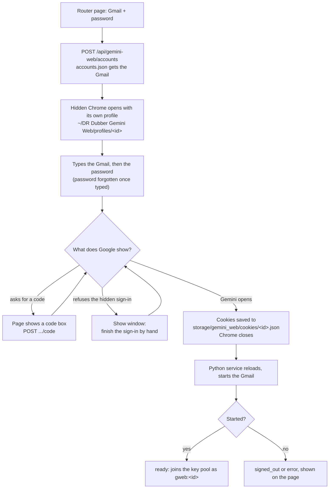

The sign-in gives up after 6 minutes.

### Answering a request

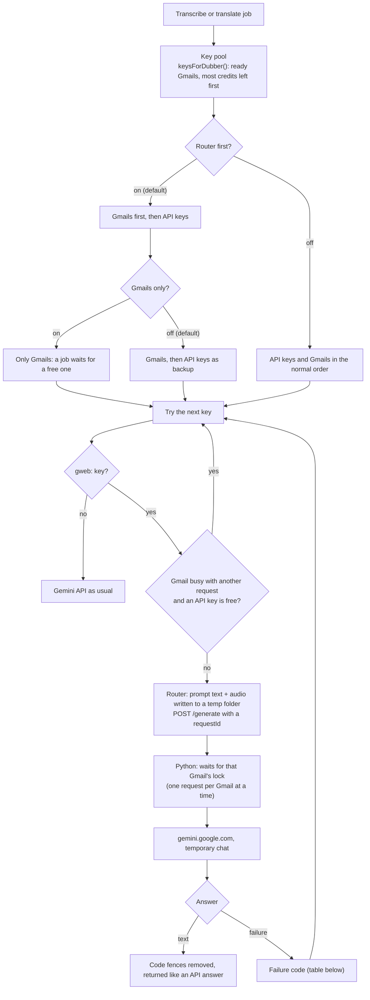

For transcription, the PC listens to the same clip while the website works, and each line takes the time at which its own Chinese characters are spoken. In testing, the website's own start times were a median 3.7 s off; corrected lines land a median 0.23 s from the API's. If an answer covers less than 75% of the speech the PC heard, the clip is asked once more and the fuller answer is kept. The timing and this check work for Chinese speech only. For other languages the website's own times are kept, and an answer is judged by its line count, as for API keys (until 2026-11-17, every non-Chinese clip was asked twice). Without the VoxCPM2 install, the website's own times are used.

**Failure codes.** These are what the Python service answers and what the job sees:

| Service code | Job sees | What happens |
| --- | --- | --- |
| `BUSY` | 502 `GWEB_BUSY` | The next key is tried at once; the Gmail is not parked |
| `QUOTA` | 429, daily quota | The Gmail is parked until Google's reset time for its empty credits (at least 1 minute, at most 24 hours; 30 minutes if Google gives no time) |
| `BLOCKED` | 429 | Parked for 15 minutes |
| `SIGNED_OUT`, `NOT_READY` | 502 `GWEB_SIGNED_OUT` | The next key is tried; the Router signs the Gmail back in from its Chrome profile |
| `NO_ACCOUNT` | 403 | Treated like an invalid key |
| `TIMEOUT` | 504 | The next key is tried |
| `CANCELLED` | `AbortError` | The job was stopped (see below) |

### Stopping a job

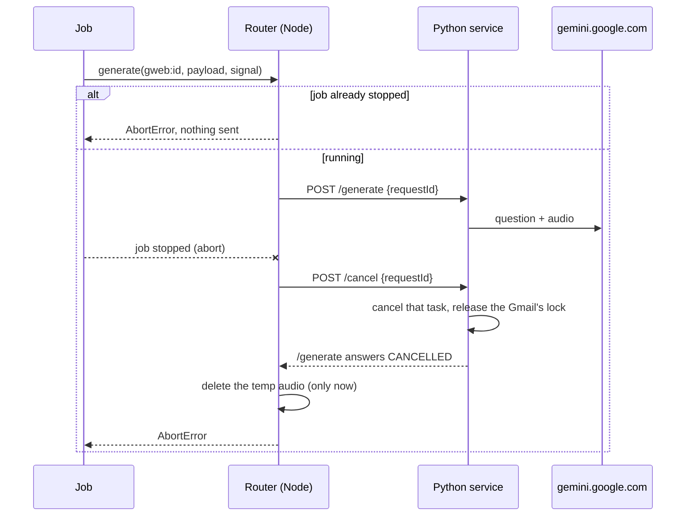

The Router waits up to 10 s for the service to let go before deleting the temp audio, so an upload is never cut off halfway. A `/cancel` that arrives before its `/generate` stops that request from starting.

### Account states

| State | Meaning |
| --- | --- |
| `starting` | Connecting with the saved cookies |
| `ready` | Takes requests |
| `limited` | Out of credits or blocked for a while; back to `ready` on its own at the reset time |
| `signed_out` | Google ended the session, or the Gmail was never signed in |
| `error` | Could not start (often a proxy that does not answer) |
| `off` | Switched off on the page |

**Keeping sign-ins alive.** Google ends a session whose cookies are used outside the browser that signed in, usually after a few hours. Every 10 minutes, and at once when a request comes back signed out, the Router opens that Gmail's Chrome profile hidden, copies its fresh cookies and restarts the Gmail. No password is needed. Each Gmail is tried at most every 10 minutes. If the profile is signed out too, the page asks you to sign in again. Gmails that are working are left alone: refreshing them on a timer caused outages in testing.

**Who answered.** While the Router is on, `routes/gemini.js` reports every answer to the Router (`noteRouterUsage` → `noteUsage`): a Gmail's answer, an API key's answer, or why a Gmail was passed over (busy, out of credits, signed out, blocked, timeout, other). The page shows the last hour and the totals since the app started, such as "90% on Gmails · 38 answers from Gmails, 4 from API keys". Check limits and CodeCraft keys are not counted. The counts are kept in memory only.

**Updating the library.** Google changes gemini.google.com now and then, and the pinned `gemini_webapi` can stop working until an app release. **Update** on the page (`POST /api/gemini-web/lib-update`, `startLibUpdate`) works like this:
1. Saves the installed packages (`pip freeze` → `rollback-packages.txt`).
2. Installs the newest `gemini_webapi` and restarts the service.
3. Waits for the Gmails to reconnect, then sends one test request through a ready Gmail. If no Gmail was ready before, only the service start is checked.
4. If anything fails, installs the saved packages again and restarts the service with them.

While it runs, Gmails are out of the key pool (jobs use API keys) and the sign-in keeper waits. Update is refused while a Gmail is working on a job, while a Gmail is signing in, or when another DR Dubber copy runs the service. The newest version is looked up on PyPI at most every 6 hours, and the installed version is recorded in `ready.json`. A fresh **Install** still installs the pinned version (`LIB_VERSION`, 2.1.1).

**Proxies.** A Gmail can use a proxy: one typed in, one from the `proxies` list in `settings.json`, or a free public one when **Free proxies** is on. A proxy that stops answering is replaced at the next check. Free public proxies drop often; for steady accounts, use your own proxies or none. DR Router PRO used to fill the `proxies` list. It has been removed, and nothing edits that list now.

### Settings

Saved in `storage/gemini_web/settings.json`.

| Setting | Default | Effect |
| --- | --- | --- |
| `useForDubbing` | on | Gmails join the key pool. Turning it off also turns off the next two |
| `routerFirst` | on | Gmails go before API keys, and a job gets one lane per Gmail |
| `gmailOnly` | off | No API keys while any Gmail is there; jobs wait for a free Gmail |
| `freeProxies` | on | Free public proxies may fill in when your own run out |
| `model` | each Gmail's default | A model name, used only by Gmails that offer it |
| `thinking` | standard | `extended` asks for extended thinking |

### Files

| Path | Contents |
| --- | --- |
| `storage/gemini_web/accounts.json` | Gmails: id, email, on/off, proxy |
| `storage/gemini_web/cookies/<id>.json` | Each Gmail's sign-in cookies |
| `storage/gemini_web/cookie_cache/` | Cookies the library renews while running |
| `storage/gemini_web/proxy_history.json` | Free proxies that worked before |
| `~/DR Dubber Gemini Web/venv/` | The Router's Python environment |
| `~/DR Dubber Gemini Web/ready.json`, `rollback-packages.txt` | Installed library version; the packages saved before the last update |
| `~/DR Dubber Gemini Web/profiles/<id>/` | Each Gmail's sign-in Chrome profile (kept outside the app folder so `npm test` does not pick up Chrome's own test files) |

Removing a Gmail on the page deletes its cookies and its Chrome profile.

## 11. Voices

**Generate Audio** voices the selected lines; **Generate All Tabs** voices every tab. With VoxCPM2 switched on, lines go to VoxCPM2; otherwise they go to Edge TTS.

### Edge TTS

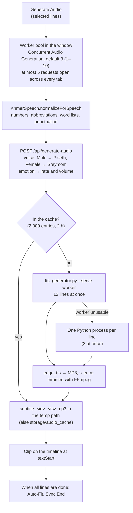

- **Text** (`khmer-speech.js`). It drops speaker tags and HTML, then applies, in order:
  - the user's pronunciation list;
  - reading Khmer abbreviations aloud;
  - fixed respellings of known mispronunciations;
  - numbers, money, percentages and dates as Khmer words;
  - Khmer for English titles, and Khmer letter names for acronyms;
  - the automatic pronunciation list;
  - tidying the punctuation.
- **Voice.** Each role (Hero, Mother and so on) maps to its gender's voice: `km-KH-PisethNeural` or `km-KH-SreymomNeural`. Other target languages use fixed Edge voices.
- **Emotion** changes only the rate and volume, never the pitch:

  | Emotion | Volume | Rate |
  | --- | --- | --- |
  | Angry | +15% | +12% |
  | Sad | −10% | −12% |
  | Whisper | −25% | −8% |
  | Excited | +10% | +15% |
  | Royal | +5% | −5% |
  | Fear | +5% | +18% |
- **Speed** is not baked into the file. It plays as `playbackRate` in the editor and as FFmpeg `atempo` in the render.
- **Retries.** Up to 8 tries per line, waiting 1.5 s and doubling each time, up to 30 s (3 s base after a network error). A 4xx other than 429 is not retried. A Microsoft 403 refusal gets one more try.
- **Requests from the window** (`withVoiceRequestSlot` in `studio-main.js`). At most 5 Edge requests are open at once across every tab; the other lines wait in the window. The window sends only 6 requests to one server at a time and queues the rest inside Chromium, where **Generate All Tabs** used to park 40–60 lines; on 2026-11-18 such a queue failed all at once (64 and then 43 lines "Failed to fetch" in the same millisecond, the server fine). Five, not six, leaves one connection for Transcribe and the status checks. Test: `tests/voice-and-bgm-load.test.js`.
- **Worker** (`lib/tts-worker.js`). One `tts_generator.py --serve` process, talking JSON lines over stdin and stdout, with a 300 s timeout per line. If the worker dies, only its in-flight lines fail. After 3 deaths in a row, each line uses its own process.
- **Microsoft busy.** "No audio was received" is Microsoft turning a line away for a few seconds, not a problem with the text. The worker tries that line again itself, up to 10 times (about 30 s of waits: 1.5 s, 3 s, then 4.5 s each), and keeps sending the other lines meanwhile; only then does the line go back to the window's own retries. There is no gate that holds every line back: one (down to 2 at once, then no line for 30-60 s) made 150 lines take 500-1427 s instead of ~220 s, and lines ran past the server's time limit (240 s, only for a stuck worker). Test: `tests/tts-edge-busy.test.js`.
- **Failed requests to the backend.** `main.js` passes `session.webRequest.onErrorOccurred` for `localhost:3001` to `lib/request-errors.js`, which writes each burst as one line with Chromium's reason, e.g. `[Network] 43 request(s) from the window to the app's server failed: net::ERR_NETWORK_CHANGED (POST /api/generate-audio x43)`. `ERR_ABORTED` (Stop) and `ERR_CACHE_MISS` (cache-only lookups) are left out.
- **Trim.** Silence below −45 dB is cut, keeping 10 ms before the voice and 80 ms after. Inner pauses over 0.5 s become 0.3 s.

### VoxCPM2

VoxCPM2 clones voices. It runs as its own local server on port 8808, installed and started by the app.

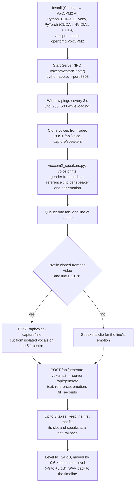

- **Install** (`lib/voxcpm-installer.js`). The default folder is `~/DR Dubber VoxCPM2`, needing 12 GB free. Every step can be run again to resume or repair. A stalled model download restarts, up to 4 tries.
- **Server** (`voxcpm2_server.py`):
  - `GET /` answers 503 while the model loads and 200 when it is ready.
  - `POST /api/generate` makes one line.
  - `POST /api/speakers` says who speaks each line.
  - `POST /api/release` frees the GPU. Isolate BGM calls it before using the GPU, and the next line loads the model again.
  - **Idle unload.** After 15 minutes with no line spoken, the server unloads the model on any device (several GB of RAM on a PC without NVIDIA, held all session before); the next line loads it again, about 40 s. `VOXCPM_IDLE_MINUTES` changes the 15, and `0` keeps it loaded. Test: `tests/voxcpm-idle-unload.test.js`.
- **Consistency.** Each voice has a fixed seed and a fixed Khmer "anchor" line, so it sounds the same in every line. Asking for the same line again draws a new take.
- **Too-long lines** are shortened once before voicing, using an estimate of 9 letters per second.
- **Fallback.** If VoxCPM2 is switched off during a run, the remaining lines go to Edge TTS.
- **One voice set per series.** Voice prints are kept in `localStorage.voxSpeakerPrints`, so later episodes reuse the same voices. `vox-groups.js` keeps one voice set per movie.

### Pronunciation checker

The checker runs in the background and works on Edge voices only. It needs the VoxCPM2 environment and a Khmer Whisper model (`whisper-small-khmer`).
- **Input.** Lines from saved transcripts.
- **Comparison.** Each line is spoken by Edge and by Google Translate's voice, and both recordings are written down by the speech recogniser. A word Edge keeps getting wrong becomes a suspect.
- **Fixes.** Respellings of the suspect are tried in example lines. One is kept only if it is clearly better, and is saved in `storage/pronunciation/state.json`.
- **Use.** The window reads the fixes and applies them before Edge speaks. The user's own list always wins.
- **When it runs.** 60 s after launch, and after each saved transcript.

## 12. Fitting voices to the timeline

A line's **slot** is `textEnd − textStart`. For a line matched to the video's own subtitles, it is the time until 0.1 s before the next line, if that is longer. A line is **rushed** when its voice must play at 1.15× or faster to fit; the amber "N rushed" chip counts these lines.

| Tool | What it does |
| --- | --- |
| **Auto-Fit** (Off / Weak / Med / Strong) | Speeds up a voice that runs into the next line, within 0.90–1.20×. The overlap allowed is +0.15 s, 0 or −0.15 s. Runs after every generation |
| **Sync End** | Moves the subtitle's end to the voice's end, except for lines matched to the video |
| **Fit Audio Slot** | Sets every voice's speed to fill its slot, within 0.90–1.20×, slowing short voices too |
| **Fix Rushed Lines → give free time** | Extends the line into free time after it (gaining at least 0.2 s, never past 0.05 s before the next line), then plays it at 1.0× if it fits, otherwise as fast as needed up to 2.5× |
| **Fix Rushed Lines → AI shorten** | `POST /api/condense-fast-subtitles`, 40 lines per request. The results are drafts to review; **Apply** voices them again at 1.0× |

In a series run, this happens without the user:
1. Rushed lines are extended into free time.
2. Lines still at 1.3× or faster are shortened, up to 6 tabs at once.
3. Short voices are slowed to the actor's length (down to 0.85×).
4. Lines that need a stretch of at least 4% are voiced again by Edge at a matching rate (−15% to +35%).

## 13. Isolate BGM

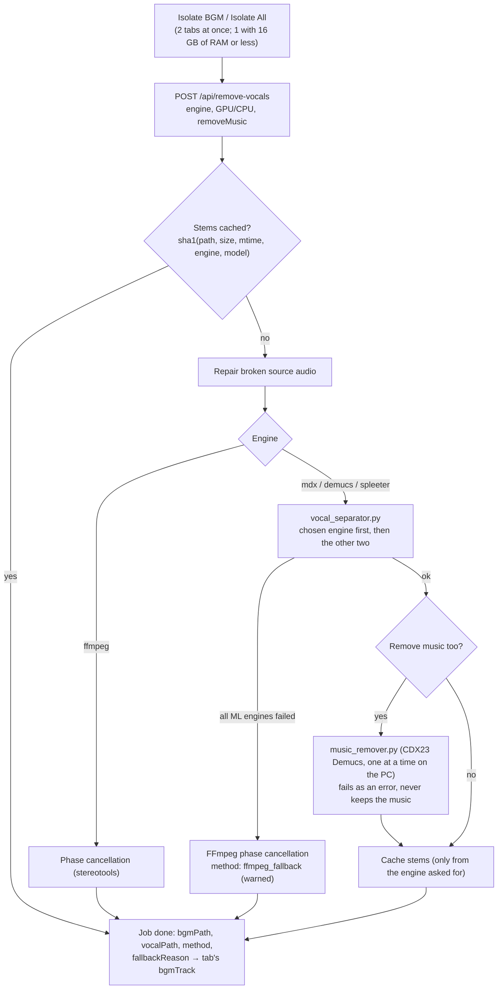

- **Engines.** MDX-Net (`UVR-MDX-NET-Voc_FT`, ONNX) is the default. Demucs runs `htdemucs` with two stems, and Spleeter runs 2 stems. MDX-Net uses DirectML on Windows and Core ML on a Mac, and moves to the CPU if the GPU fails or gives back invalid numbers (`MDX_DEVICE=cpu`, set by **Hardware Acceleration → CPU**, keeps it there). Only the Windows setup puts the model in `backend/models`; elsewhere it is downloaded once (64 MB, sha256-checked) into `storage/models`. Without it every tab fell back to Spleeter.
- **Remove music** (`music_remover.py`, CDX23) runs in the Demucs Python, on NVIDIA's GPU, else Apple's (MPS), else the CPU; a GPU failure or NaN output redoes it on the CPU.
- **Memory.** Measured on a 10-minute tab (M4, 16 GB); the stems are the same bit for bit as before these changes:

  | Step | Peak RAM | How it is kept down |
  | --- | --- | --- |
  | MDX-Net | 0.9 GB on Core ML, 1.7 GB on the CPU (was 1.4 / 3.1) | Decoded, separated and written a ~6 s chunk at a time (`stream_stem`), never the whole track; no ONNX memory-pattern planning on the CPU |
  | Remove music | 3.7 GB on Apple's GPU, 1.9 GB on the CPU (was 6.1 / 3.1) | `separate_sfx`: Demucs' own segment loop, keeping only the effects stem and writing it as it goes (`apply_model` held all three stems of the whole tab) |
  | Spleeter | about 6.4 GB | The whole tab through TensorFlow at once; nothing to stream |

  Spleeter and Remove music each run one at a time on the PC (`one_at_a_time` in `vocal_separator.py`, a file lock the OS drops when Stop kills the holder); a waiting job logs that it waits. **Isolate All** does `isolateTabs` tabs at once from **Settings → Performance** (`lib/pc-profile.js`: 1 with 16 GB of RAM or less or on a light PC, else 2; `bgmTabsAtOnce` falls back to `app:getHardwareSpecs` until the profile has loaded).
- **Waiting for free RAM.** Right before its Python starts, a separation (needs 2 GB free) or Remove music (2.5 GB) waits while free RAM is short and another of our heavy jobs runs (`waitForBgmMemory` → `lib/memory-guard.js`: separations, exports, subtitle searches and previews count). Never when nothing of ours runs, never longer than 20 minutes; Stop ends the wait. On a Mac free RAM comes from `vm_stat` (free + inactive + speculative + purgeable pages), since `os.freemem()` leaves out what macOS frees on demand. Tests: `tests/onnx-separator.test.js`, `tests/music-remover.test.js`, `tests/spleeter-one-at-a-time.test.js`, `tests/voice-and-bgm-load.test.js`.
- **GPU sharing.** Before a GPU separation, the backend asks VoxCPM2 to release the GPU. If it can't, the separation runs on the CPU.
- **Status.** The window polls `/api/bgm-job-status` every 2.5 s. **Stop** marks the job cancelled, then kills the process tree.
- **Cache.** `storage/separated/bgm-cache/` keeps stems for 14 days and at most 4 GB. Work folders are removed after 24 h.
- **Warnings.** The window warns when FFmpeg was the fallback ("may have almost no music") and when another engine stood in for the one chosen.

## 14. Blur Subtitles and Match Subtitles to Video

### Finding burned-in subtitles

`POST /api/detect-text` queues `text_detector.py <video> --fps 4`, at most `min(4, cpus/4)` at once (1 on a light PC, **Settings → Performance**), each about 0.5 GB of RAM; the next one waits while free RAM is short (`lib/memory-guard.js`). Its subtitle strip is decoded by NVIDIA's decoder, or VideoToolbox on a Mac (`DR_TEXT_HWACCEL` picks another, or `none`); without one it is decoded on the CPU. Results are cached in `storage/text_detect/`. While any detection runs, exports run at lower priority and new exports wait (section 15).

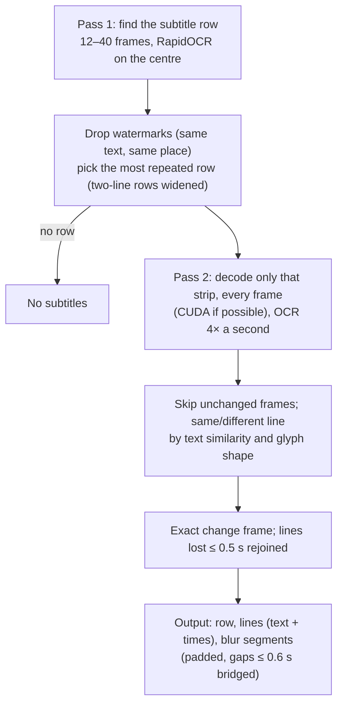

- **Preview.** A CSS `backdrop-filter` blur over the active segments.
- **Export.** `lib/text-blur.js` snaps the segments to a grid and groups them into strips. Each strip gets one crop → boxblur → feathered mask → overlay chain, with each box enabled only during its own times. The blur is applied to the source picture before flip, crop and scale, so it stays on the text.

### Match Subtitles to Video (`screen-sync.js`)

This re-times the transcribed lines to the subtitles burned into the picture.
1. **Anchors.** Pairs that are surely the same line (at least 4 letters, 80% alike, within 30 s) measure how far the transcription drifts.
2. **Pairing.** Every line is shifted by the drift, then paired with on-screen lines in order. The score weighs shared letters, time overlap and distance (at most 2.5 s apart). One line may cover several on-screen subtitles (`screenParts`, with the translation split by share).
3. **Leftovers.** A second pass searches up to 8 s away, staying between matched neighbours, up to 5 times.
4. **The rest.** Unmatched lines are moved by the drift.

Each voice moves with its subtitle, and the subtitle margin is set so the Khmer sits where the original subtitles were. On-screen lines that no subtitle covers can then be voiced with "voice on-screen lines" (section 9).

## 15. Render

The window builds a config from the tab: voice clips with speed, pitch and reverb; BGM; ducking; loudness; subtitles laid out by `subtitle-layout.js`; blur; colour; crop; free text; output name. Missing voices are generated first. It sends `POST /api/render`, then polls `/api/render-progress?token=` every 500 ms.

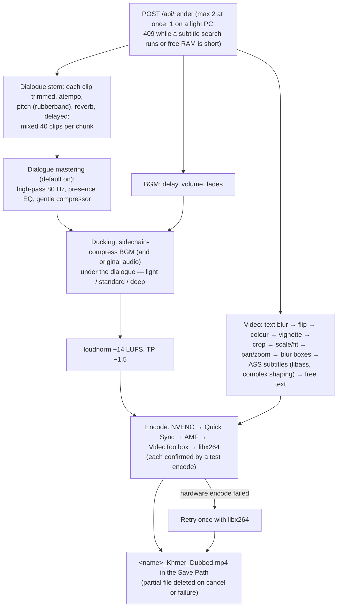

- **Encoder choice.** The render engine setting defaults to GPU (Auto) (`renderEngineSetting` in `studio-main.js`); a saved CPU choice is kept. Auto uses the first hardware encoder that passes its test, and `libx264` when none does, so a PC with no usable GPU exports exactly as with CPU. Until 2026-11-17 the default was CPU. Test: `tests/render-engine-default.test.js`.
- **Bitrate.** Follows the source (`backend/export_video_settings.js`): 2.5x the source video bitrate, times the square root of any upscale, rounded up to a step of 1000/1500/2000/3000/3500/4500/6500k. At least 3500k at 1080p, 2000k at 720p and 1500k below (HD whatever the source; Quick Sync VMAF on upscaled 720p drama with Khmer subtitles: 2000k 96, 3000k 98, 6500k 99); at most 6500k (720p and above) or 4500k, the old fixed values, which are also used when the source bitrate is unknown. Until 2026-11-25 it was always the fixed value: a 3 h series of 0.3 Mbps 720p episodes came out at 9 GB (about 5 GB now). Fixed steps because the bitrate is written into the H.264 header, and parts must match to be joined without re-encoding. libx264 uses `veryfast -crf 20`; audio is AAC 192k. Test: `tests/export-video-settings.test.js`.
- **Frame rate.** Kept from the source, unless the source reports at least 1.5x the rate its frames really come at (a split piece said 50 fps for 25): then the nearest standard rate to the real one.
- **GPU decoding.** NVIDIA cards also decode on the GPU, and a Mac decodes with VideoToolbox (the same frames bit for bit, a little less CPU). If that fails, the render retries once without it, and the rest of the session decodes on the CPU. An export takes about 0.25–0.35 GB (720p, measured on a Mac). Test: `tests/render-hw-decode-mac.test.js`.
- **Subtitles.** Burned in as ASS with the bundled fonts. HarfBuzz shaping is needed for Khmer. If FFmpeg has no subtitle filter, the subtitles are added as a soft track instead.
- **Colour.** The colour presets ("Drama LUT") only set slider values. No `.cube` files are used.
- **Missing voices.** If the voice files are missing, the render fails instead of exporting a silent video.
- **Render queue** (`studio-main.js`). **Add to Queue** stores a snapshot of the tab's config. Two renders run at once. **Stop** cancels each one by its token.

## 16. Join episodes and split movie

### Join (`episode_joiner.js`)

1. **Scan** (`/api/episodes/scan`). Each file gets an episode number from patterns such as EP, E, 第, Episode and 集; otherwise from the last number after tags like 1080p and years are removed. The scan warns about duplicate or missing numbers.
2. **Group** into parts in the window (`planEpisodeParts`). A part closes when the next episode would take it over the target × 1.08. A last part under 35% of the target joins the one before.
3. **Join each part:**
   - **Audio.** Each episode is decoded, resampled to 48 kHz, padded or trimmed to its exact length, then encoded once to AAC.
   - **Video.** Stream copy when every episode's codec headers match. If at least half match, only the odd episodes are re-encoded, with the export's own hardware encoder (read from the encoder tag) and its bitrate step (found by a 1 s test encode per step), and kept only if the headers then match. A full conversion uses 1.1x the episodes' average bitrate (it was 1.3x the highest). Otherwise everything is encoded to the most common size and frame rate.
   - **Unreadable video.** An episode whose video codec FFmpeg doesn't know (ffprobe `unknown`; ByteDance BVC2 from Douyin / Hongguo, tag `bvc2`) is marked unreadable by the scan, with a warning to download it again as H.264 or HEVC, and fails its part if it is sent anyway. Until 2026-11-25 such a part failed only at video conversion, and the job then sat at 0%: an audio decoder started after the stop wrote to the stopped encoder forever. The audio half now stops when its encoder has gone.
   - **Output.** `<series>_partNN.mp4` and `_episodes.txt` (each episode's start time). The file is written as `.part.mp4` and renamed when complete. A part is reused if its episodes have not changed.

### Split (`video_splitter.js`)

The tab count is chosen by the caller (1–40 pieces of at least 120 s each). Each cut is searched within ±min(90 s, 15% of a piece) of its target:
1. If `_episodes.txt` exists, an episode start near the target is used, snapped to a keyframe within 1.5 s.
2. Otherwise the quietest keyframe in the speech band wins, which keeps a line from being cut in half.

The file is stream-copied with the segment muxer to `<base>_partNN.ext`, plus `<base>_parts.txt`.

## 17. Dub Whole Series

The whole run is orchestrated in the window (`studio-main.js`, `#modal-dub-series`). The backend does the joining, splitting, transcription, isolation, detection and rendering.

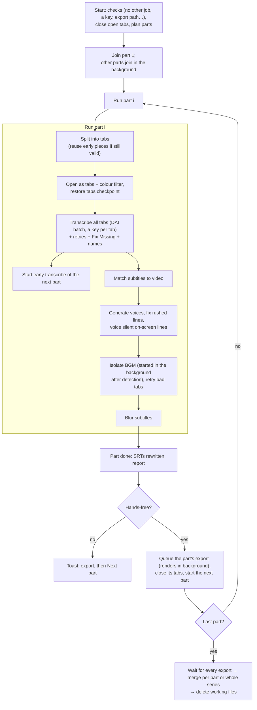

**Window settings** (saved in `aiDubberSeriesPrefs`):

| Setting | Range | Default |
| --- | --- | --- |
| Join: minutes per part | 5–180 | 50 |
| Split: minutes per tab | 3–60 | 7 |
| Episodes at once | 1, 2, 3, 5, 8, 10, 13, 15, 20 | 8 |
| Retry failed | Off, 1, 2, 3, 5 | 2 |

The other settings:
- **Videos are already merged** (each file is one part).
- **Each episode its own tab** (nothing is joined or split).
- **Steps.** A step can be switched off while the run goes.
- **Drama style**, **Colour filter**, **Hands-free**.
- **Join into one video**, per part or for the whole series.
- **Delete working files.**

**Splitting.** Tabs per part = round(duration ÷ tab length), clamped to 1–20 and lowered while a piece would be under 120 s. Pieces go to `DR Dubber Split`, and joined parts to `DR Dubber Joined`.

**Early transcribe.** Right after a part's Transcribe step, the next joined part is cut and transcribed in the background (`daiStudio.transcribeFilesEarly`). The server saves each result to `batch_results`. When that part starts, its pieces are reused only if the tab length is the same, the file's length is within 1 s, and every piece is still readable. Its Transcribe step then finds the results ready.

**Progress and resume.**
- **The plan.** `localStorage.aiDubberSeriesRun` holds the parts, their status, the step states and the auto-resume counters.
- **Tabs checkpoint.** `series_<id>_part<N>_tabs`, saved to the backend every 30 s and after each step. It holds each tab's state matched by video path, so finished steps stay finished.
- **Export checkpoint.** `series_<id>_part<N>_export` holds the render queue items. Both checkpoints are deleted when the part is fully exported.
- **Continue.** Restores lost exports, dubs a part again if its tabs and export are both gone, and otherwise runs the next unfinished part.
- **Hands-free auto-resume:**

  | Kind of stop | Waits | Tries |
  | --- | --- | --- |
  | Quota used up | 15 min, 30 min, then 60 min | 16 (about 14¾ hours) |
  | Busy, network, rate limit, 503 | 3 min | 3 |
  | Another job running | 3 min | 20 |
  | Something to fix in Settings (engine, key refused, VoxCPM2, Edge 403, export failed) | waits for the user | — |

  After a restart, a hands-free run that was still going continues after at least 60 s.

## 18. Background jobs and batch transcription

**Background jobs.** Chromium allows only 6 open connections to localhost, so long requests don't hold one open:
- `POST /api/transcribe` and `POST /api/repair-subtitles` are wrapped in `backgroundable`. With an `X-Background-Job: <id>` header they answer at once, and the window polls `GET /api/job-result?id=` every second (`backend-jobs.js`, `postJob`).
- Results are kept for 30 minutes.
- An `unknown` answer means the backend restarted and the job was lost.
- The window gives up if the backend refuses connections for 2 minutes, or doesn't answer for 20 minutes.
- Server work is stopped with `/api/cancel-transcribe`.

Reloading the window does not stop backend jobs, because they run in the main process. The window's job ids are lost on reload, though, so a reload falls back on what is on disk: saved batch results, the 3-hour clip cache and piece memory, series checkpoints and the plan.

**DAI-Transcribe Studio** (`dai-transcribe-studio.js`) has a Batch tab (a queue of files), a Translator tab and a glossary. **Transcribe All Tabs** routes through it when every tab has a file on disk.

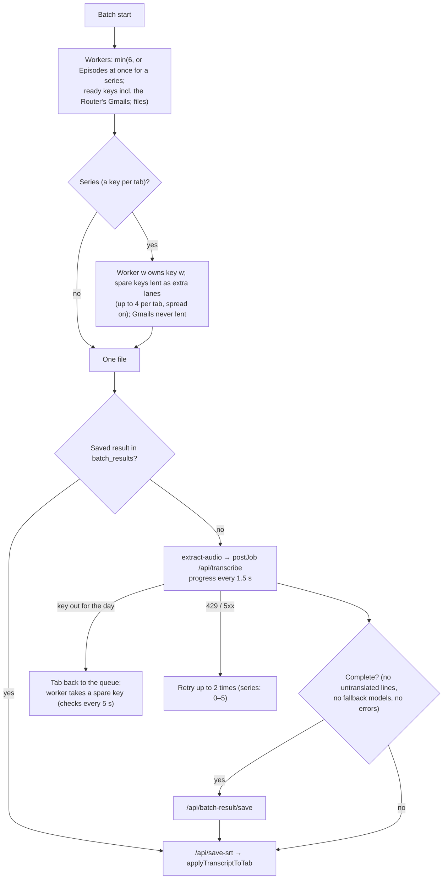

**Gemini Web Router Gmails in a batch.** At the start of a batch, and whenever a tab needs a spare key, the batch asks `GET /api/gemini-web/dubber-keys` for the ready Gmails (`gweb:<id>`) and merges them with the Settings keys (`mergeRouterKeys`):
- With **Router first**, the Gmails come first, so each ready Gmail owns a tab and the Settings keys are backups.
- With **Gmails only**, the Gmails are used alone.
- A Gmail-owned tab gets `floor(Gmails ÷ tabs)` lanes (at least 1), and Gmails are never lent as spread lanes, so no Gmail is asked for twice.
- Example: 10 Gmails, 2 API keys and **Episodes at once** 8 run 8 tabs at once, each on its own Gmail.
- Ready Gmails also let Transcribe, Transcribe All Tabs and Dub Whole Series start without any API key in Settings.

DR Router's `window.drPool` did this until it was removed on 2026-11-16 (commit bcb7540). It was restored on 2026-11-17; in between, a series ran only as many tabs as there were Settings keys. Tests: `tests/batch-workers.test.js`, `tests/gemini-web-lib-update.test.js`.

Batch results are saved as `storage/batch_results/<sha1(path|size|mtime)>.json`. A changed file is transcribed again. When every key is out, the batch stops with `quotaOut`, which pauses a series run.

## 19. Preview and waveforms

- **Preview copies** (`media_preview.js`). If Chromium can't play a file, a playable copy is made in the background, 2 at a time. A remux is used when possible; otherwise the audio is converted to AAC, or the video is re-encoded to 720p H.264. Copies are cached by file and kind of conversion.
- **Original audio waveform** (`/api/audio-peaks`). The audio is decoded at 8 kHz mono, with one peak per 1/20 s. The last 12 files are cached.
- **Timeline** (`timeline-visuals.js`). Up to 60 thumbnails, plus a 160-point waveform per dubbed clip, decoded in the window.

## 20. HTTP API reference

All routes are under `http://127.0.0.1:3001` and need the token (section 3).

### `backend/server.js`

| Method | Path | Purpose |
| --- | --- | --- |
| GET | `/api/job-result?id=` | Result of a background job |
| ALL | `/api/audio?path=` | Stream a local media, subtitle, image or font file |
| POST | `/api/extract-audio` | Audio out of a video (upload or path) |
| POST | `/api/save-transcribe-audio` | Save the transcription audio |
| POST | `/api/save-srt`, `/api/batch-save-srts` | Save SRTs |
| POST | `/api/batch-result/get`, `/api/batch-result/save` | Finished transcripts per file |
| POST | `/api/remove-vocals` | Start Isolate BGM |
| GET | `/api/bgm-job-status?jobId=` | Isolate BGM status |
| POST | `/api/cancel-remove-vocals` | Stop Isolate BGM |
| GET | `/api/check-whisper-folder` | Check a Whisper folder |
| POST | `/api/generate-audio` | One Edge TTS line |
| POST | `/api/generate-voxcmp2` | Proxy to the VoxCPM2 server |
| POST | `/api/save-audio-file` | Write base64 audio to a file |
| GET | `/api/characters` | Voice presets |

### `backend/routes/gemini.js` (`/api`)

| Method | Path | Purpose |
| --- | --- | --- |
| POST | `/transcribe` | Direct transcription (backgroundable) |
| POST | `/repair-subtitles` | Fix Missing (backgroundable) |
| POST | `/translate-srt` | Translate an SRT |
| POST | `/detect-emotions` | Emotion per line |
| POST | `/rewrite-dialogue` | Rewrite one line in a tone |
| POST | `/refactor-subtitles-batch` | AI Refactor |
| POST | `/condense-fast-subtitles` | Shorten rushed lines |
| POST | `/translate-missing-lines` | Voice on-screen lines with no subtitle |
| POST | `/split-joined-lines` | Split a line over several on-screen subtitles |
| GET | `/transcribe-progress?requestId=` | Progress |
| POST | `/cancel-transcribe` | Stop any request by `requestId` |
| POST | `/gemini-key-status` | Known state of each key |
| POST | `/gemini-check-limits`; GET `/gemini-check-limits/progress` | Check limits |
| POST | `/gemini-keys-added` | Clear marks on newly added keys |
| POST | `/text-ai`, `/codecraft/keys` | Text provider settings; check CodeCraft keys |
| POST | `/suggest-movie-title` | Khmer titles |
| POST | `/unify-names` | Names for Make names consistent |

### `backend/routes/gemini-web.js` (`/api/gemini-web`)

| Method | Path | Purpose |
| --- | --- | --- |
| GET | `/status` (`?quota=1` refreshes credits) | Router state |
| GET | `/dubber-keys` | Ready Gmails as `gweb:` keys, with the Router first / Gmails only settings, for the window's batches |
| POST | `/install` | Install the Python environment |
| POST | `/lib-update` | Update `gemini_webapi`, test it, roll back if it fails |
| POST | `/settings` | Change settings |
| POST | `/accounts` | Add a Gmail and start its sign-in |
| POST | `/accounts/:id/signin`, `/code`, `/show`, `/cancel` | Sign-in steps |
| POST | `/accounts/:id/enabled`, `/proxy`, `/auto-proxy`; `/auto-proxy-all` | Account settings |
| DELETE | `/accounts/:id` | Remove a Gmail |
| POST | `/test` | Test request |

### Other routes (`/api`)

| File | Method and path | Purpose |
| --- | --- | --- |
| `render.js` | POST `/render`, GET `/render-progress?token=`, POST `/cancel-render` | Exports |
| `text-detect.js` | POST `/detect-text`, GET `/detect-text-status`, POST `/cancel-detect-text` | Subtitle detection |
| `episodes.js` | POST `/episodes/scan`, `/episodes/join`, GET `/episodes/status`, POST `/episodes/cancel`, `/episodes/delete-working` | Join episodes |
| `split.js` | POST `/split/inspect`, `/split/start`, GET `/split/status`, POST `/split/cancel` | Split a movie |
| `series-checkpoint.js` | POST `/series-checkpoint`, GET `/series-checkpoint?key=`, POST `/series-checkpoint/files-exist`, `/series-checkpoint/delete` | Series checkpoints |
| `voice-capture.js` | POST `/voice-capture/window`, `/save`, `/speakers`, `/line`; GET `/voice-capture/default-dir` | Voice clips and speakers |
| `pronunciation.js` | GET `/pronunciation`, POST `/pronunciation/enabled`, `/pronunciation/reject` | Pronunciation checker |
| `preview.js` | POST `/check-video-preview`, GET `/preview-status`, POST `/cancel-preview` | Preview copies |
| `waveform.js` | POST `/audio-peaks` | Waveform peaks |
| `system.js` | GET `/hardware-encoders`, `/voices`, `/system-fonts`, `/system-memory`, `/performance`, `/select-folder`; POST `/performance`, `/open-folder`, `/open-logs-folder`, `/log-error`, `/log-audio-gen`, `/log-transcription`, `/clear-logs` | System info; the four log routes do nothing |

### Local services

| Service | Port | Endpoints |
| --- | --- | --- |
| VoxCPM2 | 8808 | GET `/` (also `/health`), POST `/api/generate` (alias `/generate`), `/api/speakers`, `/api/release` |
| Gemini Web | 8790 | GET `/status`; POST `/reload`, `/generate`, `/cancel`, `/quota`, `/test-proxies` |

## 21. IPC reference

`preload.js` exposes `window.electronAPI`. Every handler in `main.js` checks that the caller is the app's own origin.

| Channel | Purpose |
| --- | --- |
| `app:getBackendPort`, `app:getVersion`, `app:getHardwareSpecs`, `app:getDriveSpace` | App and machine info |
| `app:getCacheSize`, `app:clearCache` | Cache size; **Clear Cache** |
| `dialog:openFile`, `dialog:openMultiFile`, `dialog:selectFolder` | Native pickers |
| `app:checkPathExists`, `app:saveSrt`, `app:saveTextFile`, `app:autoSaveSrt` | Folders and saving |
| `app:readFileAsBase64` (audio only), `app:readFileAsText` (subtitle and text files only) | Reading files |
| `app:openExternal` | Open a web link, or an existing local folder |
| `whisper:checkFolder`, `whisper:transcribe`, `whisper:cancel`; event `whisper:log` | Local Whisper |
| `voxcpm2:startServer`, `voxcpm2:stopServer`, `voxcpm2:serverStatus`; events `voxcpm2:log`, `voxcpm2:serverStopped` | VoxCPM2 server |
| `voxcpm2:installInfo`, `voxcpm2:install`, `voxcpm2:cancelInstall`; event `voxcpm2:installProgress` | VoxCPM2 install |
| `preset:save`, `preset:load`, `preset:delete` | `presets.json` |
| `window:setProgress` | Taskbar progress |
| `app:getDeviceFingerprint`, `app:confirmQuit`, `dr-router:googleLogin`, `window:minimize/maximize/close`, `voxcpm2:writeLog`; event `app:requestQuit` | Unused or no-ops (see section 22) |

## 22. Known issues and loose ends

These were found while writing this document.

**Fixed on 2026-11-17:**
- AI Refactor and single-line rewrite now rotate over every API key the window sends (`generateTextForKey` in `gemini.js`). Before, they used only the first key. Test: `tests/text-all-keys.test.js`.
- Auto-save copies the SRT to `C:\Export\AIDubber\outputs` on Windows only (`app:autoSaveSrt` in `main.js`). On macOS it used to create a folder with that literal name in the working folder.
- The Router's messages no longer tell users to add proxies in the removed DR Router PRO.
- API Saver is **on** unless switched off, everywhere. The editor and its Settings checkbox used to read an unset value as off, while DAI batch, Dub Whole Series and the server read it as on. Test: `tests/api-saver-default.test.js`.

**Still open:**

| Issue | Where |
| --- | --- |
| Setting `PORT` moves the backend but not the window, which always loads port 3001. Nothing loads `.env`, although `.env.example` suggests it | `main.js`, `server.js` |
| DR Router PRO leftovers in code: `dr-router:googleLogin` IPC with no caller, `drRouterFastMode()` that always returns false, `getDRRouterKeys` as an alias, two unused Khmer translations, and comments | `main.js`, `preload.js`, `gemini.js`, `i18n-km.js` |
| Nothing edits the Router's own proxy list since DR Router PRO was removed | `settings.json` `proxies` |
| IPC with no caller in the window: `getDeviceFingerprint`, `readFileAsText`, `confirmQuit`, presets, window controls; `app:requestQuit` is never sent | `preload.js`, `main.js` |
| `transcribeClipWithGeminiWeb` checks `ctx.hasAlternativeKey`, which nothing sets (`apiBackup` is set) | `gemini.js` |
| `backend/python/transcriber.py` is not called by anything | — |
| On macOS and Linux, stopping Whisper may kill only its shell wrapper, because the process isn't started detached (not verified) | `main.js` |
| The editor's blur preview radius (0.12 × height) and the export's (0.25 × height) differ; a comment says they look the same (not verified by eye) | `studio-main.js`, `lib/text-blur.js` |
