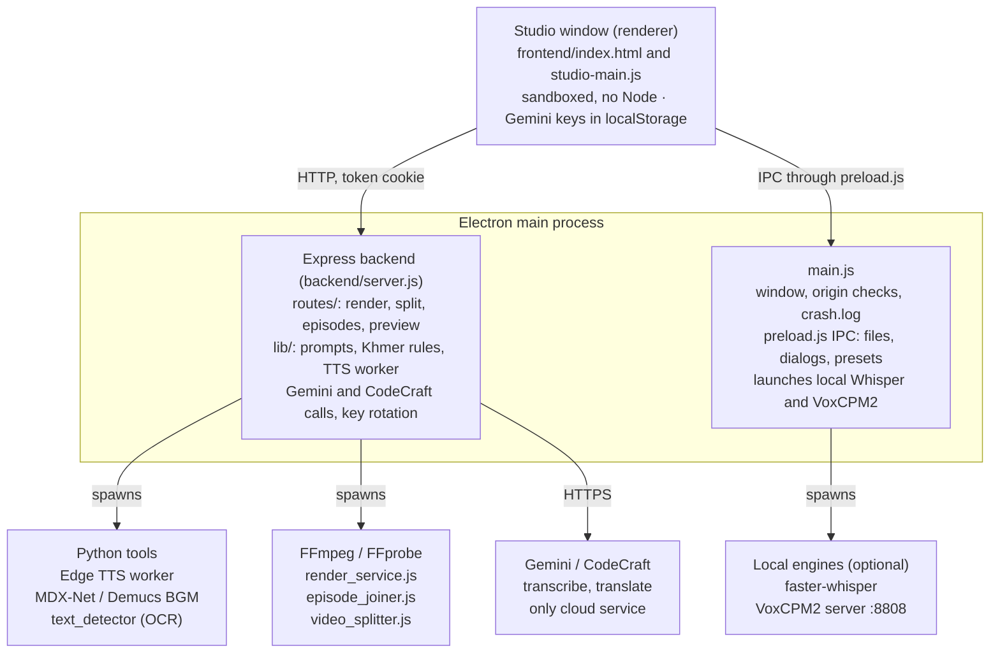

# DR Dubber Pro — Documentation

Last updated: 2026-10-14

## Overview

DR Dubber Pro turns a foreign-language video into a finished Khmer-dubbed video on your own computer. It transcribes the speech, translates it into natural Khmer, voices each line with text-to-speech, keeps the original music and effects, and renders the final video. The current release is v1.6.0.

It is built for editors who dub drama series into Khmer, often a whole season at a time. It is an Electron desktop app with a local Node.js/Express backend; FFmpeg and a few Python tools do the media work. Windows is the main platform; macOS works for development.

| Stage | What it does | Engines |
| --- | --- | --- |
| Transcribe | Turns speech into timed subtitles | Gemini direct, or on-device faster-whisper then translation |
| Translate | Drama-aware Khmer translation with genre styles; keeps character names consistent across episodes, shortens lines too long for their slot | Gemini (or a CodeCraft `cc_` key) |
| Voice | Speaks each line with per-line emotion, speed and pitch; keeps each line's Male/Female voice | Edge TTS `km-KH-PisethNeural`, `km-KH-SreymomNeural`; optional VoxCPM2 cloning |
| Isolate BGM | Removes the original voices, keeps music and effects | MDX-Net (default), Demucs, Spleeter, FFmpeg |
| Blur subtitles | Finds burned-in on-screen text and blurs it | RapidOCR |
| Render | Encodes the final video with styled subtitles | FFmpeg with hardware encoder detection |

## Getting started

Install Node.js 22, FFmpeg and a Gemini key, then `npm install` and `npm start`. Nothing else needs configuring: every setting has a working default.

| Requirement | Needed for |
| --- | --- |
| Node.js 22 and npm | Running and building the app |
| FFmpeg / FFprobe | All media work. Put the binaries in `backend/bin/` or on `PATH`; WinGet installs are found automatically. |
| Python 3.11 | TTS, transcription, BGM separation and text detection. On Windows, `setup_python_env.bat` downloads a portable copy. |
| Gemini API key (or a CodeCraft `cc_` key) | Transcription and translation. Entered in the app's Settings, never in `.env`. |

### Install and run

1. Clone and install dependencies:

   ```bash
   git clone https://github.com/chhordalim14/dr-dubber.git
   cd dr-dubber
   npm install
   ```
2. On Windows, set up the bundled Python environment (Edge TTS, the text detector and the MDX-Net model, about 64 MB): run `setup_python_env.bat`.
3. Start the app with `npm start`. This builds the Tailwind CSS, then launches Electron. You can also double-click `Run-DR-Dubber-Pro.bat` (Windows) or `Run-DR-Dubber-Pro.command` (macOS).
4. Open **Settings** and paste your Gemini key. Add spare keys too: series dubbing rotates through them when one hits its quota.

### Optional engines

| Engine | Setup |
| --- | --- |
| Spleeter (BGM) | `setup_spleeter.bat` creates `backend/spleeter-env`; not shipped in the installer |
| Demucs (BGM) | `pip install -r backend/python/requirements-demucs.txt` into `backend/demucs-env` |
| Local Whisper | Follow `whisper_engine/README.md`, then pick the folder in **Settings → General → Transcription Engine** |

### Developer scripts

| Command | What it does |
| --- | --- |
| `npm start` | Builds the CSS and launches the Electron app |
| `npm run server` | Runs only the backend (`backend/server.js`) |
| `npm test` | Runs the test suite with `node --test` (36 test files in `tests/`) |
| `npm run watch:css` | Rebuilds `frontend/css/tailwind-built.css` on every change |
| `npm run dist:win` | Builds the Windows installer and portable exe into `release/`; fails unless `setup_python_env.bat` has run |
| `npm run dist:mac` | Builds the macOS `.dmg` and `.zip` |

## Using the app

A single video goes Load → Transcribe → Generate Audio → Isolate BGM → Blur Subtitles → Render. A whole season goes through **Dub Whole Series**, which runs the same steps for each part without you.

### Where things are

The rail on the left opens a drawer for each area. The subtitle panel on the right has three tabs.

| Area | What it holds |
| --- | --- |
| **Media** | Load Video, Import SRT, Join Episodes, Split Movie, Dub Whole Series, DAI-Transcribe Studio (Batch), Clear All Data |
| **Audio** | Isolate BGM (and Isolate All), Load Background Music, Auto-Ducking (Light −8 dB, Standard −14 dB default, Deep −20 dB), Mute Original Video Audio |
| **Video** | Blur Censor, Blur Subtitles, Match Subtitles to Video |
| **Series** | Opens the Dub Whole Series window |
| **Effects** | Color, Vignette, Video Presets, Aspect Ratio, Crop |
| Subtitles tab | Language, Add Text, Transcribe, Edit, Delete, Find (Ctrl+H) |
| AI Dubbing tab | Drama genre, DAI-Transcribe, All Tabs menu, Fix Missing, AI Refactor (Natural & Short, Ultra-Short, Dramatic, Royal, Comedy) |
| Voice tab | Male / Female / profile per line, Reverb, Auto-Fit, Sync End, Fit Audio Slot, Fix Fast Audio, Generate Audio, Generate All Tabs |

### Dub one video

1. **Media › Load Video**, or **Open Video** in the header to open it in a new tab.
2. **Subtitles › Transcribe**. In Direct mode Gemini writes Khmer subtitles straight from the speech. To bring your own, use **Import SRT**.
3. Check the translation. **Fix Missing** re-translates only lines with no Khmer; **AI Refactor** rewrites lines in a chosen tone.
4. In **Voice**, assign **Male** (Piseth) or **Female** (Sreymom) and press **Generate Audio**. If a line sounds rushed, use **Fix Fast Audio** to shorten its text, or **Fit Audio Slot** to change its tempo.
5. **Audio › Isolate BGM** removes the original voices and keeps the music.
6. **Video › Blur Subtitles** hides burned-in text. **Match Subtitles to Video** re-times lines to the picture.
7. Fine-tune on the timeline: Zoom, Split, and per-clip Speed (0.5–2.5), Vol (0–5) and Pitch (±12).
8. **Export › Render Video**. Choose Video + Audio or Audio Only, a subtitle style (Classic Cinema, TikTok Pop, Neon Cyan, Royal Gold), loudness normalisation to −14 LUFS and the file name, then **Start Render** or **Add to Queue**. **Export SRT** saves just the subtitles.

Every button in the **All Tabs** menu runs that step on every open tab, so you can load all episodes, then transcribe, fix, blur and translate them in one go.

### Dub a whole series

1. Open **Series** and **Choose Folder** with the episodes.
2. Set **Join: minutes per part** (default 50) and **Split: minutes per tab** (default 7). Episodes are joined into parts, and each part is split into tabs.
3. If your videos are already one per part, tick **Videos are already merged**. It ticks itself when every video is 20 minutes or longer.
4. Pick the steps (Transcribe, Match subtitles, Generate voices, Isolate BGM, Blur subtitles; all on by default) and a Drama Style.
5. Optional looks applied to every tab:
   - **Color filter**: a Color Studio preset (a Drama LUT or a saved custom one).
   - **Image overlay**: place images on one tab with the Image tool, then press **Use this tab's images**.
   - **Clips between episodes**: **Add clip** places an intro or bumper after episode k.
6. Turn on **Hands-free** to export each part and start the next one, and **Join into one video** to join a part's tabs after export.
7. Press **Start**.

Progress is saved after every step. After a Stop, a quota pause or a restart, **Continue** picks up where it left off. In Hands-free mode it also resumes by itself: up to 16 tries over about 14 hours for a used-up daily quota, which resets at midnight Pacific. Problems you must fix in Settings wait for you to press Continue.

## Settings

Most choices live in **Settings** (General, API Keys, VoxCPM2 AI, Theme, Shortcuts, Statistics, About), with a search box at the top. Settings are saved per user in the app; API keys are never read from `.env`.

### Interface language

Switch between English and Khmer with **EN / ខ្មែរ** in the header or **Settings → General → Interface Language**. The default is English. This changes only the app's own labels; subtitles and dubbing stay Khmer either way. The translator is `frontend/js/i18n.js` and its English → Khmer dictionary is `frontend/js/i18n-km.js`.

### General settings

| Setting | Options | Default |
| --- | --- | --- |
| Gemini AI Model | Supported Gemini models; a saved model Google has retired switches to a working one | — |
| API Saver mode | One request per episode, up to 10 min | Off |
| Transcription Engine | Direct (Gemini), Whisper + Translate | Direct (Gemini) |
| Vocal Removal Engine | MDX-Net (Best), Demucs, Spleeter, FFmpeg (Instant) | MDX-Net |
| Hardware Acceleration (Vocal Removal) | GPU, CPU | GPU on Windows, CPU on macOS |
| Demucs Segment Size | 1–7 | 7 |
| Final Video Rendering | CPU (x264), GPU (Auto) | — |
| Concurrent Audio Generation | 1–10 | 3 |
| Save Path (For Exported Video) | Any folder | `C:\Export\AIDubber` on Windows |
| Generated Audio Temp Path | Any folder | `C:\Temp\AIDubber` on Windows |
| Auto Save Subtitle | After transcription, with gender tag, beside the source or in a custom folder | — |

**API Keys** holds one or more Gemini keys. Add several from different Google projects: the backend rotates through them, skips invalid ones and parks rate-limited ones. **Theme** offers nine presets (Midnight Violet, Studio Grey, Coral Sunset, Sky Blue, Fresh Mint, Classic Indigo, Midnight Blue, Forest Green, Rose Gold). **About → Check for Updates** checks for a new release.

### Environment overrides

Only needed to override a default. Copy `.env.example` to `.env`:

| Variable | Default | Purpose |
| --- | --- | --- |
| `PORT` | `3001` | Port of the local backend |
| `APP_STORAGE_DIR` | `./storage` in development; the app-data folder when installed | Uploads, separated audio, exports and logs |
| `PYTHON_PATH` / `PYTHON_BIN` | Auto-detected (bundled `backend/python_env` first) | Python used for the ML tools |

### Where files are stored

| What | Where |
| --- | --- |
| Rendered videos | The Save Path; if none is set, `storage/exports` |
| Transcription output | The custom folder, else the video's own folder, else `storage/outputs` |
| Working data | `storage/`: uploads, audio\_cache, separated, preview\_cache, audio\_repair, exports, outputs |
| Logs | `storage/logs`: `crash.log`, `server.log`, `voxcpm_debug.log`. **Settings → General → Open Logs** opens the folder. |
| Presets and device files | The Electron userData folder: `presets.json`, `approved-programs.json`, `device_id.txt` |

`storage/` sits in the project folder during development and under the user's app-data folder when installed. **Clear Cache** in Settings empties the caches; **Media › Clear All Data** resets the studio.

## How it works

Everything runs on the user's computer except the calls to Gemini or CodeCraft. The Electron main process loads the Express backend in-process; the window talks to it over HTTP on 127.0.0.1:3001, and FFmpeg and Python do the media work as child processes.



The window never reaches the internet or the file system directly: it asks the backend over HTTP, or `main.js` over IPC for files and dialogs.

### Security

- The backend listens on 127.0.0.1 only and rejects a foreign `Host` or `Origin` header.
- Each launch makes a random 32-byte token, sent to the window as the HttpOnly, SameSite=strict cookie `drd_token` (or the `x-drd-token` header). See `backend/lib/security.js`.
- The window runs with `contextIsolation`, `sandbox` and no Node integration. Every IPC handler checks that the caller is the app's own origin; outside links open in the system browser.
- Outgoing HTTPS goes through `backend/lib/secure-fetch.js`, which uses Electron's `net.fetch` and the OS certificate store.

### Key modules

| Module | Role |
| --- | --- |
| `backend/server.js` | Express app (about 4,500 lines): transcribe, translate, TTS and BGM endpoints, Gemini key rotation |
| `backend/routes/` | Render, preview, waveform, episodes, split, text detection, system info |
| `backend/render_service.js` | FFmpeg render pipeline |
| `backend/episode_joiner.js` | Joins short episodes into parts of about an hour |
| `backend/video_splitter.js` | Cuts parts into pieces on keyframes in quiet moments, so no line is split |
| `backend/lib/tts-worker.js` | Keeps one Edge TTS worker alive; falls back to a process per line if it keeps dying |
| `backend/lib/khmer-prompts.js` | Khmer dubbing rules and prompts; budget of 4.5 syllables per second |
| `backend/lib/text-rules.js` | Strips Latin and other scripts that leak into Khmer lines; builds TTS arguments |
| `backend/lib/character-sheet.js` | Per-series names, genders and forms of address, shared across episodes |
| `backend/lib/codecraft.js` | CodeCraft gateway client for `cc_` keys; text jobs only, audio always goes to Google |
| `backend/lib/bgm-cache.js` | Caches separated stems by file, engine and model |
| `backend/lib/process-tracker.js` | Kills every spawned FFmpeg or Python process on exit |
| `frontend/js/studio-main.js` | The editor and nearly all UI logic (about 29,000 lines), including the series run |
| `frontend/js/subtitle-layout.js` | One subtitle layout shared by the preview and the export, so they match |
| `frontend/js/khmer-speech.js` | Turns numbers and similar text into spoken Khmer before TTS |
| `frontend/js/i18n.js`, `i18n-km.js` | English / Khmer interface |

### Gemini calls and key rotation

Only the backend calls Gemini; the window sends the saved keys with each request. For text jobs, CodeCraft keys go first, then Gemini keys. The backend picks the least-busy free key, skips invalid and rate-limited ones, and backs off on a 503 overload instead of burning keys.

### Render pipeline

1. Build the dialogue track: each clip gets its speed and delay, then all clips are mixed in chunks.
2. Build the audio: BGM with fades, sidechain ducking under the voices, loudness normalisation to −14 LUFS.
3. Build the video: scale, crop and pad, chroma key, overlays, blur over detected text, and subtitles burned in as ASS through libass with the bundled fonts.
4. Encode with the best working encoder: NVENC, then Quick Sync, then AMF, then VideoToolbox, then libx264. Each is confirmed with a test encode; if a hardware encode fails, the render retries once with libx264.

On cancel, FFmpeg is killed, the temp folder is removed, and a partial output file is deleted only if this render created it.

### Series run

1. Join episodes into parts (`/api/episodes`).
2. For each part, split it into pieces (`/api/split`) and open them as tabs.
3. Across all tabs: transcribe, make names consistent, generate voices, isolate BGM, blur text, fit rushed lines.
4. Export through the render queue.

The plan and each step's result are kept in `localStorage` under `aiDubberSeriesRun`, which is what lets **Continue** resume.

## Releases and updates

A release is a version bump, a Windows installer on GitHub Releases, and an edit to `update.json` on `main`. Installed apps learn about it only when someone presses **Settings → About → Check for Updates**; there is no check at startup.

### How an installed app finds an update

1. The app fetches `https://raw.githubusercontent.com/chhordalim14/dr-dubber/main/update.json` (8 s timeout).
2. It compares `version` with its own version.
3. If newer, it shows a dialog with `notes`.
4. **Start Update** opens `link` (Windows) or `mac_link` (macOS) in the browser. The user downloads and runs the installer; the app does not download it itself.

| Field | Meaning | Today |
| --- | --- | --- |
| `version` | Latest version, compared as semver | `1.6.0` |
| `link` | Windows installer URL | `DR.Dubber.Pro.Setup.1.6.0.exe` on the v1.6.0 release |
| `mac_link` | macOS `.dmg` URL | Still the v1.2.1 arm64 `.dmg` |
| `notes` | Release notes shown in the dialog and the app's release notes | v1.6.0 notes |

### Cutting a release

1. Bump `version` in `package.json`.
2. On Windows, run `setup_python_env.bat` (it fetches the MDX-Net model; `npm run dist:win` refuses to build without it), then `npm run dist:win`.
3. Upload the installer from `release/` to a new GitHub release tagged `vX.Y.Z`.
4. Update `update.json` with the new `version`, `link` and `notes`, and push it to `main`. Apps see the update from that moment.

CI (`.github/workflows/test.yml`) runs on every push and pull request on Windows with Node 22: `npm ci`, a syntax check of `main.js`, `backend/server.js` and `preload.js`, then `npm test`. It never launches Electron, so check the UI by hand before tagging.

## Troubleshooting

Most failures are a used-up Gemini quota, a missing Python or FFmpeg, or a BGM engine that does not suit the machine. Start with the logs: **Settings → General → Open Logs** (`storage/logs/server.log` and `crash.log`).

| You see | Cause | Fix |
| --- | --- | --- |
| "Please add at least one Gemini API Key in Settings." | No key saved | Add a key in **Settings → API Keys** |
| "Google reports the daily free Gemini quota used up on all N API key(s)…" | Every key hit its daily limit | Wait for the reset at midnight Pacific, pick another Gemini model, or add a key from another Google project |
| "All N API key(s) are rate-limited by Google - free again in …" | Too many requests per minute | Wait the time shown; lower **Concurrent Audio Generation** or turn on **API Saver mode** |
| "Fix Missing skipped: the daily Gemini quota is used up." | Quota ran out mid-run | After the reset, run **All Tabs › Fix Missing in all tabs** |
| "No working Python environment found for text-to-speech…" | Python not found | Windows: run `setup_python_env.bat`. Otherwise install Python 3.11 with "Add to PATH" and `pip install edge-tts`, or set `PYTHON_PATH` |
| Isolate BGM crashes or hangs | GPU driver problem with MDX-Net | Set **Hardware Acceleration (Vocal Removal)** to CPU |
| "BGM is only FFmpeg phase cancellation - it may have almost no music…" | The FFmpeg fallback engine ran | Switch **Vocal Removal Engine** to MDX-Net |
| "DR Dubber Pro could not start" | Port 3001 is in use, often by a second copy | Close the other copy, or set `PORT` in `.env` |
| "Unexpected Error" dialog | An uncaught error; the app keeps running | Send `storage/logs/crash.log` with a bug report |
| Media steps fail with no clear message | FFmpeg / FFprobe not found; the app has no dedicated message for this | Put the binaries in `backend/bin/` or on `PATH` |
| A render was cancelled or failed | — | Nothing to clean up: temp files and any half-written output are deleted |
| A series run stopped | Stop, quota pause or app restart | Open **Series** and press **Continue**; it resumes from the last finished step |
